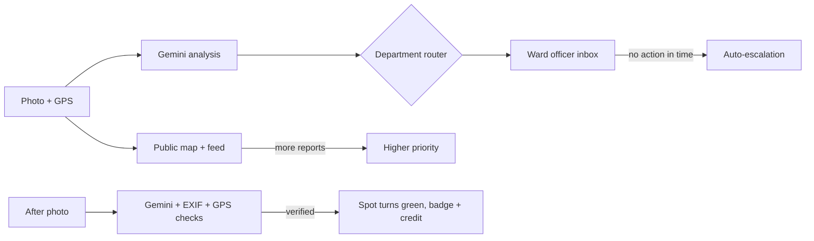

<div align="center">


# SaafSnap

**Snap the mess. We'll get it cleaned.**

One photo of garbage, a dirty river or a choked drain. Gemini works out what it is, how serious it is and which officer is responsible, then files the complaint for you. The public map turns red as more people report a spot, and stays red until someone uploads AI-verified proof that it was cleaned.


### [▶ Open the live app](https://saafsnap.vercel.app) · [Demo logins](#demo-logins) · [2-minute demo guide](#demo-for-judges-2-minutes)

</div>

---

## Try it live

Best viewed on a phone (it works on desktop too).

| Page | Link |
|---|---|
| Live app | https://saafsnap.vercel.app |
| Log in | https://saafsnap.vercel.app/login |
| Create an account | https://saafsnap.vercel.app/signup |
| Feed | https://saafsnap.vercel.app/feed |
| Pollution map | https://saafsnap.vercel.app/map |
| Leaderboard | https://saafsnap.vercel.app/leaders |
| Admin panel (admin login needed) | https://saafsnap.vercel.app/admin |
| Source code | https://github.com/Fun-with-Science/Saafsnap |

### Demo logins

| Role | Email | Password | What to try |
|---|---|---|---|
| **Admin** | `adminsaaf@gmail.com` | `admin8721` | Opens straight into the Admin panel: approve or reject NGO / government accounts, moderate reports |
| **NGO** | `greenganga@saafsnap.demo` | `ngo1234` | Green Ganga Collective: clean a reported spot, upload its logo in Settings, climb the leaderboard |
| **NGO** | `streets@saafsnap.demo` | `ngo1234` | Clean Streets Kolkata |

- **Citizens:** create your own account at [/signup](https://saafsnap.vercel.app/signup). It's instant.
- **Government officer:** sign up as **Government** and pick a department, then log in as the admin and approve it in the Admin panel. That is the real verification flow.
- The app asks for your location after login so the AI can tag where the photo was taken. You can say no and drop a pin on the map instead.
- These are shared demo accounts. Please don't delete other people's reports.

## The problem

Garbage on roads, plastic in rivers and blocked drains are everywhere, but reporting them is hard:

- People don't know **which department** handles which kind of waste.
- Complaints disappear with **no follow-up** and no public record.
- When someone does clean up, **nobody gets credit**, and fake "cleaned" claims are easy.

## The solution

SaafSnap turns a messy, real-world input (a phone photo and a location) into a structured, verified action.

| Step | What happens |
|---|---|
| **1. Snap** | Take a photo, like posting on Instagram. GPS is picked up automatically. |
| **2. AI routes it** | Gemini identifies the waste type, severity (1–10), volume, health risks and deadline, then picks the responsible department and ward officer and drafts the complaint. |
| **3. Public pressure** | Every "I saw this too" makes the spot bigger and redder on the city map. Missed deadlines escalate automatically: officer → executive engineer → commissioner. |
| **4. Clean & get credit** | Anyone (government, NGO, group or citizen) uploads an "after" photo. AI checks it's a real camera photo, at the same place, taken after the report and actually clean. The spot turns green and shows the cleaner's name and logo. |

## Features

- **Snap flow:** camera or gallery, GPS / photo GPS / tap-the-map location, animated AI scan, routed complaint letter
- **Duplicate detection:** reports within 150 m prompt you to back the existing one instead
- **Instagram-style feed:** one clean column of posts; double-tap a photo for "I saw this too"
- **Settings → Your activity:** what you reported, cleaned and backed, plus location and account settings
- **Pollution map:** priority-coloured pins and heat circles, pulsing critical spots, "near me"
- **Before / after slider** on every cleaned report
- **Animated leaderboard:** who cleans most (government vs NGOs vs citizens), a per-department government report card, and top people
- **Badges and points** with celebration animations
- **Login:** email and password; asks for location right after login
- **Roles:** Citizen (instant), NGO / Government / Group (verified by an admin)
- **Government desk:** an officer's own department inbox, overdue alerts and "start work"
- **Admin panel:** approve or reject organisations, moderate reports
- **Organisation logos:** NGOs, groups and government accounts upload their own logo in Settings
- **Mobile first:** bottom tab bar with a big camera button, tested down to 320 px wide

## Tech stack

| Layer | Tools |
|---|---|
| Frontend | React 18, Vite 5, React Router, Tailwind CSS, Framer Motion, Lucide icons |
| Maps | Leaflet + OpenStreetMap |
| AI | Gemini API with structured JSON output (`gemini-3.5-flash-lite`, automatic fallback to other models) |
| Backend | Supabase: Postgres, Auth, Storage, Realtime, row-level security |
| Offline mode | IndexedDB, used automatically when Supabase isn't configured |



## Demo for judges (2 minutes)

1. **Snap**: tap the camera, take or upload a garbage photo. Location is filled in automatically.
2. **AI routing**: Gemini names the waste, severity and risks, picks the responsible department and ward officer, and drafts the complaint with GPS coordinates.
3. **Feed**: posts lead with the place name. Double-tap an open spot for "I saw this too"; double-tap a cleaned spot to like the cleanup.
4. **Map**: spots grow redder as more people report them, and critical spots pulse.
5. **Cleanup proof**: on a report, tap "I cleaned it!" and upload an after photo. AI checks it's real, at the same place and actually clean.
6. **Leaderboard**: NGOs vs government vs citizens. If the government is behind, the government sticker dozes off and the "Wake up, Government!" banner appears.
7. **Admin**: log in with the [admin account](#demo-logins). It opens the Admin panel, where NGO and government sign-ups wait for approval.

## Getting started

```bash
git clone https://github.com/Fun-with-Science/Saafsnap.git
cd Saafsnap
npm install
cp .env.example .env   # then fill in the values below
npm run dev
```

Open http://localhost:5173.

### Environment variables

| Variable | Where to get it | Required |
|---|---|---|
| `VITE_GEMINI_API_KEY` | [Google AI Studio](https://aistudio.google.com/) → API keys | No: without it a built-in offline analyser is used |
| `VITE_GEMINI_MODEL` | Defaults to `gemini-3.5-flash-lite` | No |
| `VITE_SUPABASE_URL` | Supabase → Project Settings → API | No: without it data stays in the browser |
| `VITE_SUPABASE_ANON_KEY` | Supabase → Project Settings → API Keys (publishable key, `sb_publishable_...`) | No |

The sidebar shows which AI and data mode is active.

### Supabase setup

1. Create a project at [supabase.com](https://supabase.com).
2. Open **SQL Editor**, paste all of [`supabase/setup.sql`](supabase/setup.sql) and click **Run**. It creates the tables, security rules, photo storage and realtime, and is safe to run again.
3. Turn off **Authentication → Sign In / Providers → Email → Confirm email** if you want new users to log in without clicking an email link.
4. Put the project URL and publishable (anon) key in `.env` and restart `npm run dev`.
5. Create the admin login: set an email and a 12+ character password in [`supabase/create-admin.sql`](supabase/create-admin.sql) and run it. (Or sign up normally and run [`supabase/make-admin.sql`](supabase/make-admin.sql) with your email.)
6. Optional, for demos: run [`supabase/showcase-data.sql`](supabase/showcase-data.sql) to add 4 citizens, 2 NGOs and 8 reports. Remove them later with [`supabase/remove-demo-data.sql`](supabase/remove-demo-data.sql).

Projects created with an older `setup.sql` should also run the scripts in [`supabase/upgrades/`](supabase/upgrades) once: `grants.sql`, `likes.sql`, `hardening.sql`, `avatars.sql`.

## Offline demo mode

When you run it locally without Supabase settings, the app works entirely in the browser with 19 demo reports and these logins (one-tap buttons on the login page):

| Role | Email | Password |
|---|---|---|
| Admin | `admin@saafsnap.demo` | `admin1234` |
| Citizen | `citizen@saafsnap.demo` | `demo1234` |
| NGO | `greenganga@saafsnap.demo` | `demo1234` |
| Government (Solid Waste) | `swm@saafsnap.demo` | `demo1234` |

These exist only in offline demo mode. For the live app, use the [demo logins](#demo-logins) above.

## Project structure

```
src/
  pages/            Landing, Login, Signup, Feed, NewReport, ReportDetail,
                    MapPage, Leaders, Profile, Settings, Activity, DeptDesk, Admin
  components/       AppShell, ReportCard, MapView, LeaderChart, Stickers,
                    AiScanner, PhotoPicker, Celebration, ui (shared pieces)
  lib/
    ai.js           Gemini analysis + cleanup verification (with offline fallback)
    departments.js  Department directory, ward + escalation chain
    priority.js     Priority score, escalation timing, distances
    badges.js       Badge rules
    reportOps.js    Report state changes (offline backend)
    backend/        supabase.js (shared) and local.js (offline)
    store.jsx       App state, actions, badge celebrations
supabase/           setup.sql (schema + security), create-admin.sql, make-admin.sql,
                    showcase-data.sql, remove-demo-data.sql
  upgrades/         one-time scripts for projects created with an older setup.sql
scripts/            security-check.mjs (automated attack tests against the live backend)
public/stickers/    Government character stickers
public/seed/        Demo report photos (Wikimedia Commons, see CREDITS.md)
```

## Security

SaafSnap is a client-rendered single-page app (no server-side rendering), so all protection lives in the database and the browser.

**Database (Supabase row-level security)**
- Visitors who aren't logged in can't read anything.
- Reports can only change through database functions (back a report, like, start work, submit cleanup). Direct edits and deletes are blocked; only admins can delete.
- Nobody can make themselves admin. Organisations start as pending until an admin approves them.
- Emails are visible only to their owner and admins.
- New reports can't be created for someone else, pre-marked as cleaned, or given fake likes or crowd counts. Photos must be the uploader's own file in this project's storage.
- Text length, location range, department and report structure are checked, so malformed data is rejected.

**Storage**: users can upload only into their own folder, only JPEG/PNG/WebP, up to 5 MB.

**Browser**
- A strict Content Security Policy only allows our own scripts, and network calls only to Supabase, Gemini and the map tiles.
- The site can't be embedded in other sites (clickjacking protection), plus the usual `nosniff`, referrer and HSTS headers.
- All user text is rendered by React (auto-escaped); there is no raw HTML injection anywhere.
- Every report loaded from the database is sanitised, and error boundaries keep one bad post from breaking the page.

**Tested**: `npm run security-check` attacks the live backend with throwaway accounts (about 24 checks, including privilege escalation, fake reports, tampering and malicious uploads) and prints PASS/FAIL for each.

**Known limits** (fine for a hackathon, next steps for production):
- The Gemini key is used from the browser. Restrict it to your domain in Google Cloud, or move the calls into a Supabase Edge Function.
- Cleanup verification runs in the browser, so a determined user could fake a "verified" result. Moving it into an Edge Function closes that gap.
- `npm audit` lists advisories for the dev server (Vite/esbuild) and React Router's server-rendering and redirect features. Neither the dev server nor those features are part of the deployed site; upgrading to Vite 6+ / React Router 7 is planned.

## Credits

Demo report photos are from Wikimedia Commons under CC0 / CC BY / CC BY-SA licences. Authors and links are listed in [CREDITS.md](CREDITS.md).

## Roadmap

- Server-side Gemini calls and verification (Edge Functions)
- Real email / WhatsApp delivery of complaints to officers
- Ward boundaries from official GIS data instead of estimated wards
- Multi-language support (Hindi, Bengali)
