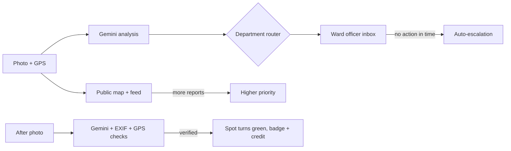

<div align="center">


# SaafSnap

**Snap the mess. We'll get it cleaned.**

One photo of garbage, a dirty river or a choked drain. Gemini works out what it is, how serious it is and which officer is responsible, then files the complaint for you. The public map turns red as more people report a spot, and stays red until someone uploads AI-verified proof that it was cleaned.


</div>

---

## The problem

Garbage on roads, plastic in rivers and blocked drains are everywhere, but reporting them is hard:

- People don't know **which department** handles which kind of waste.
- Complaints disappear with **no follow-up** and no public record.
- When someone does clean up, **nobody gets credit**, and fake "cleaned" claims are easy.

## The solution

SaafSnap turns a messy, real-world input (a phone photo and a location) into a structured, verified action.

| Step | What happens |
|---|---|
| **1. Snap** | Take a photo, like posting on Instagram. GPS is picked up automatically. |
| **2. AI routes it** | Gemini identifies the waste type, severity (1–10), volume, health risks and deadline, then picks the responsible department and ward officer and drafts the complaint. |
| **3. Public pressure** | Every "I saw this too" makes the spot bigger and redder on the city map. Missed deadlines escalate automatically: officer → executive engineer → commissioner. |
| **4. Clean & get credit** | Anyone (government, NGO, group or citizen) uploads an "after" photo. AI checks it's a real camera photo, at the same place, taken after the report and actually clean. The spot turns green and shows the cleaner's name and logo. |

## Features

- **Snap flow:** camera or gallery, GPS / photo GPS / tap-the-map location, animated AI scan, routed complaint letter
- **Duplicate detection:** reports within 150 m prompt you to back the existing one instead
- **Instagram-style feed:** double-tap a photo for "I saw this too"
- **Pollution map:** priority-coloured pins and heat circles, pulsing critical spots, "near me"
- **Before / after slider** on every cleaned report
- **Animated leaderboard:** who cleans most (government vs NGOs vs citizens), a per-department government report card, and top people
- **Badges and points** with celebration animations
- **Roles:** Citizen (instant), NGO / Government / Group (verified by an admin)
- **Government desk:** an officer's own department inbox, overdue alerts and "start work"
- **Admin panel:** approve or reject organisations, moderate reports, load demo data
- **Mobile first:** bottom tab bar with a big camera button, tested down to 320 px wide

## Tech stack

| Layer | Tools |
|---|---|
| Frontend | React 18, Vite 5, React Router, Tailwind CSS, Framer Motion, Lucide icons |
| Maps | Leaflet + OpenStreetMap |
| AI | Gemini API with structured JSON output (`gemini-3.5-flash`, automatic fallback to other models) |
| Backend | Supabase: Postgres, Auth, Storage, Realtime, row-level security |
| Offline mode | IndexedDB, used automatically when Supabase isn't configured |



## Getting started

```bash
git clone https://github.com/Fun-with-Science/Saafsnap.git
cd Saafsnap
npm install
cp .env.example .env   # then fill in the values below
npm run dev
```

Open http://localhost:5173.

### Environment variables

| Variable | Where to get it | Required |
|---|---|---|
| `VITE_GEMINI_API_KEY` | [Google AI Studio](https://aistudio.google.com/) → API keys | No: without it a built-in offline analyser is used |
| `VITE_GEMINI_MODEL` | Defaults to `gemini-3.5-flash` | No |
| `VITE_SUPABASE_URL` | Supabase → Project Settings → API | No: without it data stays in the browser |
| `VITE_SUPABASE_ANON_KEY` | Supabase → Project Settings → API (anon public key) | No |

The sidebar shows which AI and data mode is active.

### Supabase setup

1. Create a project at [supabase.com](https://supabase.com).
2. Open **SQL Editor**, paste all of [`supabase/setup.sql`](supabase/setup.sql) and click **Run**. It creates the tables, security rules, photo storage, realtime and the demo accounts. It's safe to run again.
3. For quick testing, turn off **Authentication → Sign In / Providers → Email → Confirm email**.
4. Put the project URL and anon key in `.env` and restart `npm run dev`.
5. Log in as the admin and click **Load demo reports** on the Admin page.

## Demo accounts

The login page has one-tap demo buttons.

| Role | Email | Password |
|---|---|---|
| Admin | `admin@saafsnap.demo` | `admin1234` |
| Citizen | `citizen@saafsnap.demo` | `demo1234` |
| NGO | `greenganga@saafsnap.demo` | `demo1234` |
| Government (Solid Waste) | `swm@saafsnap.demo` | `demo1234` |
| Government (Water) | `water@saafsnap.demo` | `demo1234` |
| Pending government (to test approval) | `health@saafsnap.demo` | `demo1234` |
| Pending NGO (to test approval) | `rakshak@saafsnap.demo` | `demo1234` |

Change these passwords before deploying publicly.

## Project structure

```
src/
  pages/            Landing, Login, Signup, Feed, NewReport, ReportDetail,
                    MapPage, Leaders, Profile, DeptDesk, Admin
  components/       AppShell, ReportCard, MapView, LeaderChart, Stickers,
                    AiScanner, PhotoPicker, Celebration, ui (shared pieces)
  lib/
    ai.js           Gemini analysis + cleanup verification (with offline fallback)
    departments.js  Department directory, ward + escalation chain
    priority.js     Priority score, escalation timing, distances
    badges.js       Badge rules
    reportOps.js    Report state changes (offline backend)
    backend/        supabase.js (shared) and local.js (offline)
    store.jsx       App state, actions, badge celebrations
supabase/setup.sql  Database schema, security rules, demo accounts
public/stickers/    Government character stickers
public/seed/        Demo report photos (Wikimedia Commons, see CREDITS.md)
```

## Security notes

- Reports can only change through database functions (back a report, start work, submit cleanup). There are no direct updates.
- Only admins can approve organisations or delete reports. Sign-ups can never make themselves admin.
- Emails are visible only to their owner and admins.
- The Gemini key is used from the browser, which is fine for a demo. For production, move the Gemini calls and cleanup verification into a Supabase Edge Function so the key stays secret and verification can't be faked.

## Credits

Demo report photos are from Wikimedia Commons under CC0 / CC BY / CC BY-SA licences. Authors and links are listed in [CREDITS.md](CREDITS.md).

## Roadmap

- Server-side Gemini calls and verification (Edge Functions)
- Real email / WhatsApp delivery of complaints to officers
- Ward boundaries from official GIS data instead of estimated wards
- Multi-language support (Hindi, Bengali)
